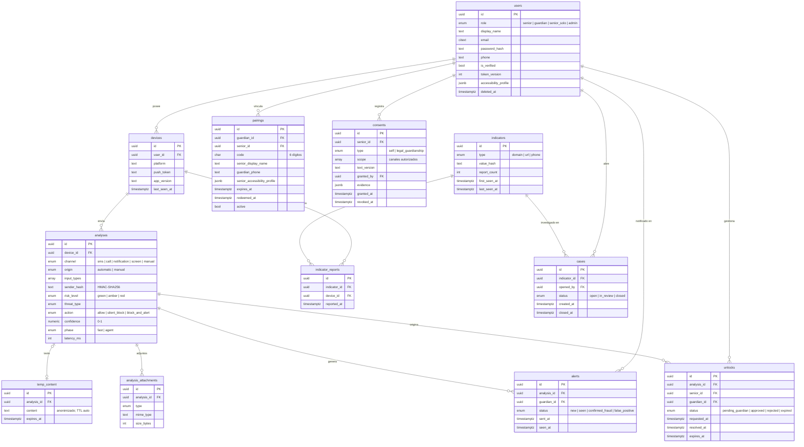

<div align="center">


<h1>Avizor</h1>

<p>Aplicación Android que protege a personas mayores frente a estafas digitales.<br/>
El mayor comparte un mensaje, enlace, llamada o archivo; Avizor responde con un semáforo<br/>
<strong>verde · ámbar · rojo</strong> y consejos concretos sobre qué hacer.</p>

<a href="https://avizor-production.up.railway.app">
  
</a>

<br/><br/>

<!-- App móvil -->


&nbsp;
<!-- Backend -->


&nbsp;
<!-- IA / ML -->


&nbsp;
<!-- Infra -->


<br/>

</div>

---

## ¿Qué es Avizor?

Las personas mayores reciben cada día mensajes de texto, correos, llamadas y notificaciones que pueden ser intentos de estafa. Detectarlos requiere experiencia digital que muchos no tienen, y los estafadores lo saben: el 70 % de las víctimas de phishing y vishing en España tienen más de 60 años.

Avizor actúa como un guardián silencioso en el teléfono del mayor. Intercepta automáticamente las notificaciones sospechosas, o el propio mayor puede reenviar cualquier mensaje dudoso directamente desde WhatsApp, SMS u otras apps. En segundos, Avizor analiza el contenido y responde con un resultado claro:

- 🟢 **Verde: seguro.** La app no hace nada más.
- 🟡 **Ámbar: sospechoso.** Se bloquea en silencio. El familiar no recibe notificación.
- 🔴 **Rojo: peligroso.** Pantalla de bloqueo con instrucciones concretas: qué hacer, a quién llamar, cómo denunciarlo.

El sistema está diseñado para que el mayor no necesite entender cómo funciona la tecnología. No hay puntuaciones, no hay tecnicismos, no hay decisiones que tomar. Si algo es peligroso, la app lo para y explica qué hacer en lenguaje sencillo.

---

## Cómo funciona

```
 Sénior comparte un mensaje, enlace, llamada o imagen
                        │
                        ▼
         Anonimización en el dispositivo          ← DNI, IBAN, tarjetas, teléfonos,
         [DNI] [IBAN] [PHONE] [EMAIL]…                correos y direcciones sustituidos por etiquetas
                                                       (nombres: solo en PDFs/imágenes, en servidor)
                        │
                        ▼
              POST /api/v1/analyses
                        │
              ┌─────────┴──────────┐
              │  Vía rápida <800ms │   texto, URL, teléfono
              │  Clasificador BETO │
              │  + reputación      │
              └─────────┬──────────┘
                        │
              ┌─────────┴──────────┐
              │  Vía manual <15s   │   imágenes, PDFs, audio
              │  OCR (Tesseract)   │
              │  + Agente RAG      │   fuentes: INCIBE, OSI, Banco de España
              │    (Groq)          │
              └─────────┬──────────┘
                        │
           ┌────────────┼────────────┐
           ▼            ▼            ▼
         GREEN         AMBER         RED
         allow     silent_block   block_and_alert
                                  pantalla de bloqueo
                                  + push al tutor
```

La IA nunca escribe texto libre al sénior. Selecciona una plantilla revisada (`DANGEROUS_LINK`, `FAKE_DO_NOT_TOUCH`, `SUSPICIOUS_CALL`…) y el sénior ve siempre instrucciones claras y probadas.

---

## Modos de uso

Avizor tiene tres perfiles distintos según la situación del mayor:

| Perfil | Quién es | Qué puede hacer |
|---|---|---|
| **Sénior vinculado** | Mayor con un familiar que lo supervisa | Recibe protección automática; su familiar configura todo |
| **Sénior autónomo** | Mayor sin tutor disponible | Se registra solo; ve su propio historial; gestiona su cuenta |
| **Tutor** | Familiar o cuidador | Recibe alertas push; revisa el historial; aprueba o rechaza desbloqueos |

**Vinculación tutor ↔ sénior:** el tutor genera un código de 6 dígitos desde su app. El sénior lo introduce en la suya. Listo: el tutor ya recibe las alertas y puede configurar el perfil de accesibilidad del mayor (tamaño de letra, daltonismo, hipoacusia) sin que el sénior tenga que tocar nada.

---

## Privacidad por diseño

La privacidad no es una opción en Avizor: es una restricción técnica que el sistema impone activamente.

- **El texto se anonimiza antes de salir del dispositivo.** DNI/NIE, IBAN, tarjetas, emails, teléfonos y direcciones se sustituyen por etiquetas antes de enviarse al servidor. Si el backend recibe texto sin anonimizar, rechaza la petición (`422 CONTENT_NOT_ANONYMIZED`).
- **Los archivos nunca se guardan.** Las imágenes, PDFs y audios se procesan en memoria del servidor y se descartan al terminar. Nunca se escriben en disco ni en base de datos.
- **El texto temporal se borra automáticamente.** Verde: mismo día. Ámbar: 7 días. Rojo: 30 días.
- **Los teléfonos se guardan solo como hash.** El número de un remitente se almacena con HMAC-SHA256; el valor real nunca sale del dispositivo.
- **Los nombres en PDFs e imágenes también se tapan.** El servidor usa spaCy (`es_core_news_md`) para detectar y reemplazar nombres de personas antes de que el texto llegue al clasificador o al agente.

---

## Accesibilidad

Cada decisión de diseño parte de que el usuario del teléfono puede tener baja visión, daltonismo, hipoacusia o no estar familiarizado con la tecnología.

**El tutor configura el perfil de accesibilidad del sénior** al crear la vinculación. El sénior no configura nada.

| Condición | Qué cambia |
|---|---|
| Baja visión o ceguera | Texto más grande en toda la app |
| Daltonismo | El semáforo lleva etiqueta de texto: SEGURO / SOSPECHOSO / PELIGRO |
| Hipoacusia | Alertas visuales más prominentes |

La app detecta automáticamente si TalkBack (lector de pantalla Android) está activo. Todos los botones tienen etiqueta en español claro, los formularios expandibles anuncian su estado y los mensajes de error se leen en voz alta en cuanto aparecen (`accessibilityLiveRegion="assertive"`).

**En el portal web** (usado por tutores): fuente sin serifa con interlineado amplio, modo sepia automático en modo oscuro para reducir el efecto de vibración visual, animaciones desactivadas si el sistema operativo lo indica (`prefers-reduced-motion`), y navegación completa por teclado con foco visible.

<details>
<summary><strong>Ver todas las decisiones de accesibilidad (ADR 0002)</strong></summary>

- Sin emojis como metáforas: se usan iconos Lucide con etiqueta de texto junto a ellos.
- Modo sepia automático en modo oscuro (fondo crema `#f5f0e8` en lugar de negro puro).
- `prefers-reduced-motion`: todas las animaciones desaparecen si el SO lo indica.
- `scroll-behavior: smooth` solo si `prefers-reduced-motion: no-preference`.
- Foco visible (`:focus-visible`) en todos los elementos interactivos para navegación por teclado.
- Toggle de contraseña visible en todos los campos (útil para personas con dislexia).
- `aria-live="polite"` en errores de formulario, código de vinculación, cuenta atrás y contadores del panel.
- Labels siempre visibles encima del campo; ningún input depende solo del placeholder.
- Formularios con un campo por línea y espaciado generoso.
- Contenedores de gráficas con `min-height` en vez de `height` fija (el texto grande del navegador no recorta el contenido).
- HTML semántico: `<nav>`, `<main>`, `<section>`, `role="tablist"`, `role="tab"`, `role="tabpanel"`.
- Separación de contenido público y autenticado: la landing no muestra datos privados a usuarios sin sesión.

Pendiente de testing con NVDA (lector de pantalla Windows). Checklist completo en [`docs/decisions/0002-accesibilidad-web.md`](docs/decisions/0002-accesibilidad-web.md).

</details>

---

## Decisiones de diseño

Las más importantes del proyecto: qué decidimos, por qué y qué cambió en la app.

**El LLM nunca escribe texto libre al sénior.** Cuando algo es peligroso, la app muestra una plantilla predefinida y revisada (`DANGEROUS_LINK`, `FAKE_DO_NOT_TOUCH`, `SUSPICIOUS_CALL`, `ASKS_BANK_DETAILS`, `LOOKS_SAFE`, `UNSURE_CALL_FAMILY`). La IA solo elige cuál mostrar. Un modelo de lenguaje puede alucinar o generar texto confuso; para una persona mayor en situación de alarma, eso es inaceptable.

**Solo Android para el sénior automático.** iOS no permite a apps de terceros leer notificaciones de otras apps ni interceptar llamadas. Es una restricción del sistema operativo de Apple, no algo que podamos resolver con código. Los tutores pueden usar cualquier plataforma.

**Sénior autónomo (`senior_solo`).** No todo el mundo tiene un familiar con tiempo y conocimientos para hacer de tutor. Este rol permite que el mayor se registre solo, vea su historial y gestione su cuenta. No puede desbloquear contenido bloqueado en el MVP: si un estafador le llama y le presiona para que lo haga, la app no se lo permite.

**React Native con Expo en lugar de Flutter.** El equipo domina TypeScript y el panel web ya estaba en ese lenguaje. Flutter requeriría aprender Dart desde cero. La consecuencia: la carpeta `android/` está commiteada en el repositorio y cualquier cambio nativo hay que hacerlo directamente en `AndroidManifest.xml` y en los ficheros Kotlin.

<details>
<summary><strong>Ver todas las decisiones (ADRs 0001–0009)</strong></summary>

**Navegación: React Navigation sobre Expo Router (ADR 0001)**
Expo Router está pensado para apps con rutas parecidas a las de una web. Avizor tiene un árbol condicionado por rol (sénior / tutor / sénior autónomo) que se controla mejor de forma explícita. Las rutas están en [`mobile/src/navigation/`](mobile/src/navigation/).

**OCR con Tesseract en servidor (ADR 0007)**
Se evaluaron ML Kit en el móvil (aumenta la APK, más trabajo), un modelo de visión de Groq (enviaría la imagen sin anonimizar a un tercero) y Tesseract local. Tesseract gana: local, sin dependencias externas, calidad suficiente para capturas en español. Las imágenes sin texto legible salen como ámbar (`UNSURE_CALL_FAMILY`), no como "seguro". Límite: 8 s y 5000 caracteres por imagen.

**Nombres tapados con spaCy md (ADR 0009)**
`regex-v0` no detecta nombres propios. Se evaluaron `es_core_news_sm` (~160 MB, confundía "Mamá" o "Receta" con nombres) y `es_core_news_md` (~350 MB, resuelve esos casos). Se eligió `md`. Carga perezosa: no gasta RAM si nadie envía archivos. Limitación conocida: datos médicos no se tapan.

**Esquema preparado para N tutores, MVP con 1 (ADR 0004)**
La tabla `pairings` admite varios tutores sin cambios de esquema. En el MVP solo hay uno. Requisito antes de activar varios: el consentimiento debe indicar a qué tutor específico autoriza el sénior, y hace falta un test de concurrencia en los desbloqueos.

**Umbral de 5 reportes para publicar indicadores (ADR 0005)**
Un dominio, URL o teléfono no aparece en el ranking público con menos de 5 reportes. Con 1 reporte ya sale ámbar en la detección; con 5, rojo y entra en el ranking. Los reportes manuales del sénior cuentan por dispositivo (no por repetición), primer paso hacia contar personas distintas.

**Borrado completo y físico de cuenta (ADR 0008)**
Al eliminar la cuenta se borra todo: usuario, dispositivos, análisis, consentimientos, alertas y desbloqueos. No es borrado lógico. Se conservan los indicadores agregados de reputación (no identifican a nadie). Se pide la contraseña antes de proceder: un móvil desbloqueado no es suficiente. Si un tutor se borra y su sénior se queda sin nadie, el sénior también se da de baja.

</details>

---

## Estructura del repositorio

```
mobile/     React Native + Expo (app Android)
backend/    FastAPI + PostgreSQL (API REST)
ml/         Clasificador BETO ONNX
rag/        RAG con Groq + ChromaDB
docs/       ADRs, contratos, arquitectura, despliegue
```

---

## Puesta en marcha local

<details>
<summary><strong>Requisitos previos</strong></summary>

- Python 3.11+
- Node.js 20+
- Docker Desktop (para la base de datos local)
- Android Studio o dispositivo físico con USB debugging
- Java 17 (para compilar la app nativa)

</details>

<details>
<summary><strong>Variables de entorno</strong></summary>

Copia `.env.example` a `.env`:

```bash
cp .env.example .env
```

Variables mínimas para desarrollo local:

| Variable | Descripción |
|---|---|
| `POSTGRES_USER / PASSWORD / DB` | Credenciales de la BD local |
| `JWT_SECRET` | `openssl rand -hex 32` |
| `PHONE_HMAC_KEY` | `openssl rand -hex 32` |
| `MAIL_PROVIDER` | `log` (imprime en terminal, no envía) |
| `CLASSIFIER_PROVIDER` | `keywords` (sin modelo ML) o `ml` |
| `AVIZOR_NER_MODEL` | `es_core_news_md` / `es_core_news_sm` / vacío |

Las claves externas (`AVIZOR_VT_KEY`, `AVIZOR_GSB_KEY`, `GROQ_API_KEY`…) son opcionales en local.

</details>

<details>
<summary><strong>Base de datos, backend y app móvil</strong></summary>

```bash
# 1. Base de datos
docker compose up -d db
cd backend
python -m venv .venv && source .venv/bin/activate   # Windows: .venv\Scripts\activate
pip install -r requirements.txt
alembic upgrade head

# 2. Backend
uvicorn app.main:app --reload
# → http://localhost:8000  |  Swagger: http://localhost:8000/docs

# 3. App móvil
cd mobile
npm install
npx expo start --android       # requiere emulador o dispositivo conectado
# npx expo run:android         # genera el APK de desarrollo
```

</details>

<details>
<summary><strong>RAG (opcional)</strong></summary>

Solo necesario si `AVIZOR_RAG_ENABLED=true`.

```bash
cd rag
pip install -r requirements.txt
# Rellena GROQ_API_KEY y CHROMA_PATH en .env
python ingest.py   # indexa el corpus (INCIBE, OSI, Banco de España)
```

</details>

---

## Base de datos

PostgreSQL 16 · 12 tablas · PKs en UUID · fechas en ISO 8601 UTC



---

## Equipo

| Nombre | GitHub |
|---|---|
| Mariajosé Alvarez | [@MajoRodri](https://github.com/MajoRodri) |
| Maria Isabel Durango | [@MariaIsaDurango](https://github.com/MariaIsaDurango) |
| Laura | [@LauraSilRu](https://github.com/LauraSilRu) |
| María Roldán | [@Mary1922](https://github.com/Mary1922) |
| José Gregorio | [@GregDev08](https://github.com/GregDev08) |

---

## Documentación adicional

- [`docs/decisions/`](docs/decisions/): ADRs (decisiones de arquitectura)
- [`docs/contract/`](docs/contract/): Contrato de schemas API v1.0.0
- [`docs/architecture/`](docs/architecture/): Diagramas de arquitectura
- [`docs/qa/`](docs/qa/): Matriz de riesgos y plan de pruebas
- [`docs/legal/`](docs/legal/): Textos RGPD y consentimiento

---

## Licencia

MIT con atribución obligatoria al equipo Avizor, al Bootcamp IA y Big Data de 1.250 h de la Fundación Somos F5 (2026) y enlace a este repositorio. Ver [LICENSE](LICENSE).
