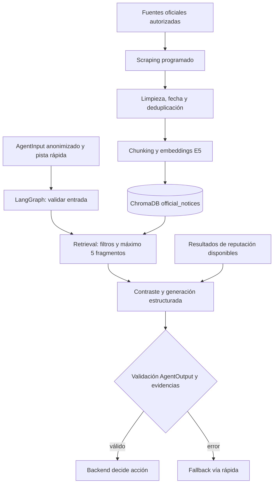

# Avizor — Arquitectura RAG e investigación de fuentes (#39)

Fecha de revisión: 17/11/2026. Estado: propuesta para revisión por el equipo. Alcance: diseño y prueba de concepto; no incluye los cuatro scrapers ni indexación productiva.

## 1. Objetivo y límites

Enriquecer el análisis manual con información oficial sobre fraudes en español. El RAG aporta contexto y evidencias, no demuestra por sí solo que un mensaje concreto sea fraudulento. El análisis automático sigue siendo responsabilidad de la vía rápida (objetivo <800 ms). No se entrenará el LLM con los avisos. Los datasets del clasificador pertenecen al módulo ML; PhishBench-External se reserva para evaluación externa, no para entrenamiento o indexación como conocimiento oficial.

## 2. Inventario de fuentes

| Fuente | Entrada y muestra | Estructura observada o prevista | Frecuencia propuesta de consulta | Derechos y limitaciones |
|---|---|---|---|---|
| INCIBE | [Avisos ciudadanía](https://www.incibe.es/ciudadania/avisos), [Phishing](https://www.incibe.es/aprendeciberseguridad/phishing) | Listado de avisos y fichas HTML; candidato RSS `https://www.incibe.es/ciudadania/avisos/feed` (pendiente de verificar directamente). | Diaria | [Aviso legal candidato](https://www.incibe.es/aviso-legal), no accesible durante la revisión; licencia de avisos no confirmada. No extrapolar licencias de materiales educativos. |
| OSI | [Portal histórico](https://www.osi.es/), [INCIBE ciudadanía](https://www.incibe.es/ciudadania) | Canal ciudadano de INCIBE; comprobar redirección y equivalencia de fichas antes de implementar. | Diaria, sin repetir peticiones a INCIBE | Licencia específica pendiente; no contar como fuente institucional independiente. |
| Policía Nacional | [Portal](https://www.policia.es/), [ejemplo nota de prensa](https://www.policia.es/_es/comunicacion_prensa_detalle.php?ID=16577&idiomaActual=es) | Fichas de prensa identificadas por ID; listado, paginación y selectores pendientes de comprobación directa. | Diaria | No se verificó aviso legal aplicable al portal de prensa. El [aviso de sede electrónica](https://sede.policia.gob.es/portalCiudadano/_es/aviso_legal.php) se refiere a otro dominio y no autoriza la reutilización de prensa. |
| Banco de España | [Protégete contra el fraude](https://clientebancario.bde.es/pcb/es/menu-horizontal/actualidadeducac/educacion-financiera/fraude-internet.html), [ejemplo](https://clientebancario.bde.es/pcb/es/blog/advertencias-del-banco-de-espana.html) | Índice temático con enlaces a artículos HTML; título y contenido textual visibles en consulta web. | Semanal | [Aviso del portal](https://clientebancario.bde.es/pcb/es/pie-de-pagina/copyright/avisolegal/) remite al [aviso general](https://www.bde.es/wbe/es/pie/aviso-legal/): atribución, reproducción fiel y otras condiciones. No es licencia abierta general; validar transformación, indexación y difusión con QA antes de ingesta completa. |

Las frecuencias son intervalos de consulta propuestos, no periodicidades oficiales de publicación; las publicaciones dependen de campañas y actividad de cada entidad. Fecha, idioma (español), canal, tipo de amenaza, procedencia y limitaciones se registrarán por aviso. La comprobación web permitió localizar muestras, pero no validar todos los robots.txt, HTML bruto ni licencias. El candidato RSS se localizó en https://feeder.co/discover/3140341ef0/incibe-es (fuente secundaria). La relación OSI/INCIBE está documentada en https://www.senado.es/web/expedientdocblobservlet?id=198753&legis=15 (respuesta gubernamental).

### Política de acceso

Antes de automatizar cada fuente: revisar condiciones de acceso y reutilización, robots.txt, licencias específicas y eventuales derechos de terceros. robots.txt no concede licencia. Preferir RSS/API si existe; limitar concurrencia a una petición por host, esperar al menos dos segundos entre solicitudes, usar timeout, identificar cliente y respetar Retry-After. Ante 401/403/429, CAPTCHA o bloqueo, detener y evaluar; no eludir restricciones. No descargar adjuntos o acceder a enlaces de fraude. No publicar HTML, corpus ni datos personales. Si no hay autorización suficiente, limitarse a referencias y consultar a QA; excluir de indexación hasta resolver.

## 3. Arquitectura propuesta

Ingestión fuera de la ruta de petición; solo el pipeline autorizado escribe en la colección. El agente utiliza una interfaz de lectura; no incorporar mensajes de usuarios a ChromaDB. Actualizar de forma idempotente: URL canónica y hash SHA256 de texto normalizado para duplicados, conservar procedencia; no tratar dos copias de INCIBE/OSI como corroboraciones independientes. Si cambia un aviso, reemplazar fragmentos y eliminar los obsoletos; si cambia el modelo, reindexar. No asignar fecha de scraping como publicación si esta falta: excluir de consulta temporal y revisar manualmente.

## 4. ChromaDB y embeddings

Colección contractual `official_notices`; ruta `CHROMA_PATH=./rag/chroma_db` relativa a raíz del proyecto (resolver ruta explícita al integrar backend). Embeddings `intfloat/multilingual-e5-base` (768 dimensiones), ejecución CPU, similitud coseno, vectores normalizados. Prefijos `passage: ` para documentos y `query: ` para consultas. Fijar y registrar versión/revisión de modelo para reproducibilidad.

| Campo | Tipo y criterio |
|---|---|
| id | `<source>:<date>:<slug>:<chunk>`; identificador estable |
| source | enum contractual rag_source (verificar valores en backend antes de integración) |
| url | URL original oficial/canónica |
| title | título original |
| published_at | fecha ISO 8601 |
| scraped_at | fecha/hora UTC ISO 8601 |
| threat_type | enum contractual, clasificación al indexar |
| impersonated_entities | CSV, no lista |
| content_hash | `sha256:...` |
| embedding_model | `multilingual-e5-base` |

### Decisión técnica consensuada — Issue #41

El equipo acuerda modificar el criterio inicial de
500–800 tokens debido al límite de entrada del modelo
multilingual-e5-base.

Configuración definitiva:

- Tamaño objetivo: 450–480 tokens.
- Tamaño máximo: 480 tokens.
- Solapamiento: 80 tokens.
- Dimensiones de embeddings: 768.
- Máximo de entrada E5: 512 tokens, incluyendo prefijos
  y tokens especiales.
- Se permiten documentos cortos y fragmentos finales
  inferiores a 450 tokens.
- No se permite truncamiento silencioso.
- Tokenización mediante el tokenizer real del modelo.

La decisión está implementada y validada en la issue #41.

La ingestión oficial utiliza CHROMA_PATH, manteniendo
separadas las bases de datos oficial y sintética.

Issue #39 y contrato: chunks de 500–800 tokens, solape 80. El [modelo E5](https://huggingface.co/intfloat/multilingual-e5-base) trunca a 512 tokens, incluyendo prefijo y tokens especiales. Propuesta: 450–480 tokens de contenido (objetivo 480), solape de 80, contando con el tokenizer real y verificando que la entrada completa no supera 512. Fragmentos finales pueden ser más cortos. No truncar silenciosamente. Alternativa si el equipo exige 500–800: mantener fragmentos padre de ese tamaño y crear subfragmentos de embedding dentro del límite; exige revisar esquema e IDs. La propuesta preferida queda pendiente de aprobación y actualización del contrato en #41; no se modifica el contrato en esta PR.

## 5. Retrieval y evidencias

Filtrar por threat_type y ventana móvil de 24 meses de publicación. ChromaDB puede requerir un campo numérico adicional para comparar fechas; proponer `published_ts` como metadato técnico derivado, sujeto a revisión contractual. Recuperar como máximo cinco fragmentos, ordenar por similitud, evitar varios fragmentos redundantes del mismo aviso. Si no hay evidencia suficiente, no inventar resultados ni asumir que el mensaje es seguro. Evaluar umbrales y tipos de amenaza con Laura y José; no fijar probabilidades a partir de similitud coseno. Cada evidencia se construye a partir de resultados reales, no de URLs generadas por el LLM; el aviso similar es indicio contextual, no prueba de identidad del remitente.

## 6. Comparativa de orquestación

| Criterio | LangGraph | CrewAI |
|---|---|---|
| Control | Nodos, estado y rutas condicionales explícitas | Flows con eventos, estado y condiciones; Crews para delegación |
| Adecuación | Pipeline breve y predecible con validación/fallback | Colaboración de agentes con roles y tareas; también soporta flujos controlados |
| Pruebas | Nodos aislables y rutas reproducibles con mocks | Tareas/flows aislables; controlar variabilidad de crews |
| Latencia | Pocas llamadas al LLM si el diseño lo limita | Puede requerir más llamadas si se delega; depende del flujo |
| Dependencias | Ya contemplado en rag/requirements.txt | Exigiría incorporar y revisar dependencia |

Propuesta: LangGraph con estado tipado, nodos deterministas y una llamada estructurada al LLM cuando proceda. No es una comparación experimental de latencia; se medirá en #43. Ambas opciones son viables. Fuentes: https://docs.langchain.com/oss/python/langgraph/overview y https://docs.crewai.com/en/concepts/flows. El proveedor y modelo LLM quedan pendientes de decisión del equipo.

## 7. Integración y seguridad

Mantener `ManualAgent` (model_version, analyze(data) -> dict), `AgentInput` (text, urls, fast_risk_level, fast_threat_type) y `AgentOutput` existentes. Salida: risk_level, threat_type, block_template, confidence, explanation (1–1000 caracteres para Tutor), evidence (hasta cinco). Verificar schema Evidence real antes de implementar #43. Validar coherencia de enums y procedencia; backend controla acción y fallback. Tratar mensajes y fragmentos recuperados como datos no confiables; no ejecutar instrucciones, no visitar URLs del usuario, no conceder herramientas autónomas al modelo. No registrar texto privado, secretos ni URL con parámetros sensibles; desactivar telemetría externa de contenido. Fijar presupuesto global de ejecución <15 s como objetivo de #43; reputación rápida <400 ms como objetivo de #42. Medir, no afirmar cumplimiento. No bajar riesgo crítico sin política aprobada y evidencia suficiente.

## 8. Evaluación y entregables

#39: inventario, diseño, comparación y PoC metadata-only, con pruebas offline. #40: extracción autorizada, diez avisos recientes por fuente si disponibles (documentar excepciones OSI y licencias). #41: pipeline y evaluación retrieval con consultas etiquetadas, Recall@5, MRR@5, duplicados, vigencia y latencia. #42: reputación y timeouts. #43: evaluación de casos legítimos, smishing, phishing, prompt injection, evidencias y fallback; medir latencia y calidad de veredictos y coordinar con QA. Los objetivos de recall >=95% y precisión >=90% en red son objetivos del clasificador/sistema, no resultados obtenidos.

## 9. Prueba de concepto

Desde raíz: `python -m pytest rag/tests/test_poc_official_source.py -q` y `python -m rag.src.scrapers.poc_official_source`. El script consulta robots.txt y una URL fija del Banco de España, extrae únicamente título y referencia sin conservar HTML ni texto completo. Verificar condiciones del portal antes de ejecutar. No sigue redirecciones ni enlaces sospechosos. Seis tests offline superados en entorno de preparación; falta ejecución en red desde el entorno del proyecto. No dar por cumplido el criterio de scraping real hasta obtener una respuesta válida. No se ha ejecutado Ruff en el entorno de preparación por no estar instalado allí; ejecutar localmente. No se modifican CI ni backend en esta issue; proponer CI RAG con el equipo.

## Validación experimental de la prueba de concepto

Fecha: 17/11/2026

### Entorno de ejecución

- Windows 11 + WSL2 Ubuntu.
- Python 3.12.3.
- Pytest 9.2.0.
- Ejecución en entorno virtual local.

### Resultados

| Indicador | Resultado |
|---|---|
| Tests ejecutados | 6 |
| Tests superados | 6 |
| Tests fallidos | 0 |
| Tests omitidos | 0 |
| Cobertura de código | 88 % |
| Tiempo de ejecución de tests | 1,36 segundos |
| Extracción real de metadatos | Exitosa |

### Validación con una fuente oficial

- Fuente: Banco de España.
- Identificador: banco_espana.
- URL: https://clientebancario.bde.es/pcb/es/blog/advertencias-del-banco-de-espana.html
- Título recuperado: ¡Cuidado con las alertas falsas del Banco de España!

### Conclusiones

La prueba de concepto demuestra la viabilidad técnica de
la extracción automatizada de metadatos de una fuente oficial.

Los seis tests unitarios han finalizado correctamente,
alcanzando una cobertura de código del 88 %.

La implementación completa de los scrapers se abordará
en la issue #40 y la indexación vectorial en la issue #41.

La viabilidad técnica no implica una autorización general
para la extracción masiva o reutilización de contenidos.