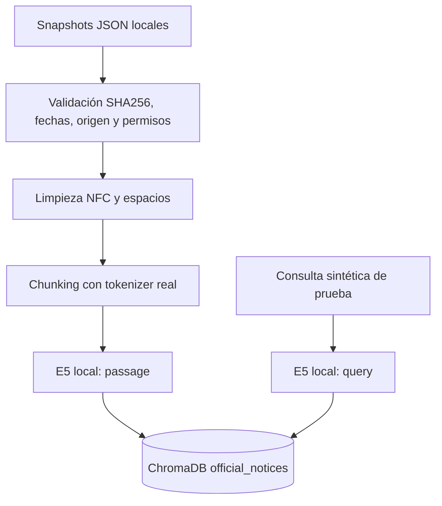

# Issue #41 — Pipeline de ingestión RAG / RAG ingestion pipeline

## Alcance y decisión técnica

El equipo ha consensuado fragmentos de 450–480 tokens, objetivo 480, solape de 80 y comprobación de la longitud final con el tokenizer real de `intfloat/multilingual-e5-base`. El máximo de entrada E5 es 512 tokens (incluyendo prefijo `passage: ` y tokens especiales); no se permite truncamiento silencioso. Los documentos cortos y los últimos fragmentos pueden ser menores de 450 tokens. El proyecto usa CPU y embeddings de 768 dimensiones normalizados L2 con distancia coseno.

Referencias: contrato de Avizor v1.0.0 (schema ChromaDB); issue #41; decisión consensuada posterior al contrato; https://huggingface.co/intfloat/multilingual-e5-base; https://cookbook.chromadb.dev/core/collections/.

## Flujo



La ingestión no realiza scraping ni visita enlaces. Los snapshots #40 son el contrato de entrada; el paso scrape se integrará y probará después de que #40 llegue a dev. El lector acepta `text`, `content_hash`, `source`, `url`, `title`, `published_at`, `scraped_at` y `reuse_reference`. La limpieza preserva texto plano y ofrece HTML explícito para entradas de prueba. Los hashes se comparan antes de vectorizar. Las entradas sin texto, fuera de los últimos 24 meses, con hashes erróneos o sin permiso documentado se rechazan.

## Metadatos e IDs

Colección `official_notices`, documentos = fragmentos. ID estable `<source>:<date>:<slug>:<chunk>`; el slug de URL incorpora un sufijo SHA256 corto para distinguir IDs de prensa y colisiones. Metadatos: source, url, title, published_at, scraped_at, threat_type, impersonated_entities (CSV), content_hash (`sha256:` más hexadecimal del documento normalizado) y embedding_model (`multilingual-e5-base`). La revisión efectiva del modelo queda registrada en metadatos de colección; un cambio obliga a crear/reindexar la colección explícitamente.

Los límites se calculan con offsets del texto original; el solape son 80 posiciones del tokenizer original. Cada fragmento se vuelve a tokenizar de forma aislada, incluida la entrada con prefijo. Se rechaza un caso que no permita respetar tamaño, límites y fronteras de caracteres; no se elimina contenido para hacerlo encajar.

## Persistencia e idempotencia

`upsert` actualiza IDs existentes. Se buscan los fragmentos anteriores por URL para eliminar los que queden obsoletos al reducir el número de chunks o cambiar la fecha. La deduplicación global por hash conserva una sola URL representativa (primera ya almacenada); no equivale a detección de duplicados semánticos. No se borra documentación ausente en un snapshot parcial. Un único escritor; no hay garantía de transacción multioperación entre upsert y delete; si se interrumpe un proceso, repetir la ingestión del documento. No utilizar esta fase como servicio concurrente de escritura.

## Separación de datos y permisos

- Demo: `rag/data/processed/issue41_demo_chroma`, colección `official_notices`, tres ejemplos inequívocamente sintéticos con URLs `example.invalid`. Las fechas ficticias se generan en el momento de la demo para que no caduquen. Nunca son evidencias oficiales.
- Corpus real: `rag/chroma_db`, modo separado y validación de cada URL, hash exacto y manifiesto revisado. No indexar los 30 textos de #40 hasta verificar fidelidad y permisos de RAG. Un manifiesto no constituye autorización legal; registra una decisión humana documentada.
- La clasificación de los ejemplos sintéticos es manual y conocida. Para entrada real la etiqueta contractual y las entidades deben venir de la revisión/clasificador en el manifiesto; automatizar con el clasificador de Laura queda pendiente de integración. No se altera el contrato de backend.
- No subir corpus real, manifiestos de permisos ni bases Chroma a Git. No ingerir mensajes de usuarios.

## Ejecución

Desde la raíz y con el entorno virtual activo:

```bash
python -m pytest rag/tests/test_issue41_ingestion.py -q -rs
python -m rag.src.ingestion.pipeline --synthetic --query "SMS falso de una empresa de paquetería"
python -m rag.src.ingestion.pipeline --synthetic --query "SMS falso de una empresa de paquetería"
```

Comparar `stored_chunks` en ambas ejecuciones el mismo día: no debe aumentar; la segunda informa actualizaciones. Verificar `maximum_tokens <= 480` y `maximum_e5_input <= 512`. Los ejemplos son repetitivos para probar ventanas y no representan un benchmark de calidad. La consulta demuestra funcionamiento básico, no evaluación cuantitativa. La recuperación definitiva con fecha, filtro de amenaza y deduplicación por aviso queda para #43.

El modelo debe estar descargado en caché. El pipeline no descarga pesos automáticamente. Si falta, comprobar primero el entorno y la caché; acordar descarga si necesaria. `--revision` permite escoger una revisión ya cacheada; se guarda el commit resuelto.

## Entrada real (deshabilitada en el flujo de trabajo actual)

La CLI exige `--input` (repetible) y `--approvals`. El archivo de aprobaciones es un objeto JSON con clave URL exacta, y por cada registro: `content_hash` (con prefijo), `rag_allowed` booleano, `reference` (respaldo documentado), `threat_type` y `impersonated_entities` CSV. No proporcionar este manifiesto hasta contar con autorización suficiente y revisión humana. No hay aprobaciones reales incluidas. Tras resolverlo, ejecutar primero la validación y revisión del corpus #40; guardar el manifiesto localmente fuera del repositorio.

## Estado de validación de esta entrega

24 pruebas aisladas aprobadas en el entorno de preparación; dos omitidas por ausencia de ChromaDB/transformers (pruebas reales de persistencia y tokenizer). La ejecución con E5, prueba de persistencia real, Ruff y regresión del backend están pendientes en el entorno del proyecto. No equivale a cierre de #41.
