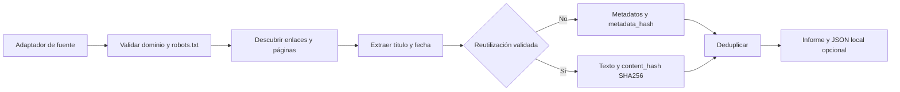

# Issue #40 — Scrapers de fuentes oficiales

**Estado:** implementación y pruebas offline; aceptación con datos reales pendiente.
**Referencia:** `rag_architecture.md` (#39), contrato de Schemas v1.0.0 y test plan de #40 (10 avisos recientes por fuente y sin duplicados).

## 1. Alcance y fuentes

| Canal contractual | Publicador | Ruta de descubrimiento | Estado de comprobación (17/11/2026) |
|---|---|---|---|
| `incibe` | INCIBE | https://www.incibe.es/ciudadania/avisos | Ruta oficial identificada; consulta web directa agotó su tiempo. HTML y paginación pendientes de ejecución local. |
| `osi` | INCIBE | https://www.incibe.es/ciudadania/blog | https://www.osi.es/ redirige a https://www.incibe.es/ciudadania/; se propone usar el blog ciudadano como canal separado para complementar los avisos. No constituye otra institución independiente y requiere validación del equipo. |
| `policia_nacional` | Policía Nacional | https://www.policia.es/_es/comunicacion_actualidad.php | Ruta candidata; consulta web redirigió al aviso de cookies. Ejemplo de ficha indexada: https://www.policia.es/_es/comunicacion_prensa_detalle.php?ID=16577&idiomaActual=es. No se automatiza aceptación de cookies ni se eluden restricciones. |
| `banco_espana` | Banco de España | https://clientebancario.bde.es/pcb/es/menu-horizontal/actualidadeducac/educacion-financiera/fraude-internet.html y https://clientebancario.bde.es/pcb/es/blog/ | Índice temático y blog consultados. PoC #39 extrajo título real. Validar fechas, selectores y paginación al ejecutar #40. |

Candidato RSS de INCIBE (`https://www.incibe.es/ciudadania/avisos/feed`) no verificado directamente; no se usa en esta entrega. No se presume que los selectores HTML sean definitivos. Los cuatro módulos contienen configuración específica y comparten un motor de extracción. Los filtros por título son heurísticos, no sustituyen el clasificador de amenazas y pueden excluir publicaciones relevantes. La selección se detiene al alcanzar el objetivo de avisos recientes, no garantiza que sean los diez más nuevos de todo el portal.

## 2. Diseño



`common.py`: configuración, fechas, HTTP, robots, selectores, normalización mínima, hashes y deduplicación. `run_scrapers.py`: CLI secuencial. Los registros raw no son todavía los chunks contractuales de ChromaDB. No se incorpora texto de usuarios, no se contactan URLs reportadas y no se descargan archivos ni imágenes.

## 3. Datos de salida

| Campo | Tipo/semántica |
|---|---|
| source | Identificador contractual |
| publisher | Organismo publicador real |
| url | URL oficial del artículo, normalizada |
| title | Título original |
| published_at | Fecha ISO 8601 de la publicación; no se sustituye por fecha de descarga |
| scraped_at | Fecha y hora UTC ISO 8601 |
| language | `es`, según la configuración del canal |
| text | Texto del artículo o null (modo metadata) |
| content_hash | `sha256:` + 64 caracteres hexadecimales del texto normalizado, o null en metadata |
| metadata_hash | SHA256 de título y fecha; no equivale a un hash del contenido |
| reuse_reference | Referencia de aprobación documentada o null |

Ventana de 24 meses naturales relativa a la fecha de ejecución. Se descartan fechas desconocidas, futuras y antiguas. `threat_type`, `impersonated_entities`, IDs de chunks y `embedding_model` se incorporarán en #41 según el contrato. El contenido sin permiso validado o sin `content_hash` no pasa a indexación.

## 4. Deduplicación y seguridad

- Normalización NFC y espacios; SHA256 del texto, sin metadatos de descarga. Una modificación real del texto puede generar un nuevo hash.
- Primero consolidar por URL (incluidas variantes `/index.php/` de INCIBE), conservar observación más reciente; después eliminar hashes de texto idénticos. En modo metadata se detectan coincidencias de título y fecha dentro del mismo organismo, no equivalencia de cuerpos.
- En ejecución `all`, deduplicación global y recuento por canal después de deduplicar. Si cae por debajo de diez, se informa como objetivo no alcanzado. No sumar un duplicado de OSI e INCIBE como dos pruebas independientes.
- Las exportaciones son snapshots que se reemplazan, no un histórico acumulativo. La idempotencia persistente y actualización de documentos/chunks se abordarán en #41. Si se requieren hashes de duplicados aproximados, se evaluará en una tarea posterior.
- Lista de dominios HTTPS exactos y rutas permitidas, sin redirecciones ni URLs externas. Parámetros de prensa limitados a ID y paginación acotada. No se recorren enlaces del contenido de un aviso.
- Respeto a `robots.txt`, con reglas de agente, comodines y prioridad de coincidencia. Pausa mínima de 2 s, presupuesto por fuente de 100 peticiones, timeout HTTP y tamaño máximo de respuesta de 2 MB. Se detiene la fuente ante errores de acceso; sin reintentos automáticos ni evasión de controles. Los errores parciales no se presentan como éxito.
- No se publican capturas HTML, corpus ni datos extraídos en Git. `rag/data/raw/` contiene un `.gitignore` local. No se ha modificado CI, backend ni dependencias. El entorno de desarrollo ya incluye HTTPX y BeautifulSoup. Revisar con QA antes de automatizar ejecución periódica.

## 5. Condiciones de acceso y reutilización

El acceso público, la consulta de robots.txt y una extracción técnica exitosa no prueban una licencia de reutilización. Revisar condiciones del portal antes de ejecutar pruebas de red, y documentar la autorización aplicable a almacenamiento e indexación. El portal del Cliente Bancario remite a https://www.bde.es/wbe/es/pie/aviso-legal/ (véase también https://clientebancario.bde.es/pcb/es/pie-de-pagina/copyright/avisolegal/); exige condiciones de atribución y fidelidad, entre otras. La transformación para RAG requiere revisión específica. Las licencias de INCIBE/OSI y del portal de prensa de Policía Nacional siguen pendientes de confirmar.

El CLI opera por defecto en modo metadatos. `--reuse-reference` es una declaración del operador de que existe una revisión documentada, **no** una autorización automática ni una comprobación jurídica. Solo utilizar para una fuente concreta cuando QA/equipo haya confirmado que la extracción, almacenamiento y uso están permitidos, conservando la referencia. Antes de indexar, revisar que no haya datos personales innecesarios en el texto. No se considera el corpus autorizado por el hecho de generarse un JSON.

## 6. Ejecución local

Desde raíz de Avizor con `.venv` activo:

```bash
python -m pytest rag/tests/test_official_scrapers.py -q --tb=short
ruff check rag
ruff format --check rag
python -m rag.src.scrapers.run_scrapers --help
```

Tras revisar condiciones, primera comprobación de metadatos por fuente:

```bash
python -m rag.src.scrapers.run_scrapers --source banco_espana --limit 1
python -m rag.src.scrapers.run_scrapers --source incibe --limit 1
python -m rag.src.scrapers.run_scrapers --source osi --limit 1
python -m rag.src.scrapers.run_scrapers --source policia_nacional --limit 1
```

Si las comprobaciones previas son correctas, ejecutar el test de red de metadatos de diez registros y deduplicación global:

```bash
python -m rag.src.scrapers.run_scrapers --source all --limit 10 --save
```

El CLI devuelve 0 si alcanza el objetivo por canal tras deduplicar y 2 si no. El informe contiene `unique_recent`, `content_records`, `errors`, `unique_after_global_dedup` y `target_met`. El JSON local `rag/data/raw/all_notices.json` puede ser parcial; no interpretarlo como una certificación. Si un origen falla, detener y revisar rutas/HTML/condiciones antes de repetir. Un `--seed-file` opcional permite pasar una lista JSON de URLs oficiales revisadas de una sola fuente, sujeta a los mismos controles; no sirve para eludir bloqueos.

Ejemplo de sintaxis de extracción de texto **solo después de aprobación documentada**, cambiando la referencia a la real:

```bash
python -m rag.src.scrapers.run_scrapers --source banco_espana --limit 10 --reuse-reference 'REFERENCIA_REAL_APROBADA' --save
```

## 7. Pruebas y aceptación

Pruebas offline con HTML sintético y `httpx.MockTransport`: extracción de metadatos, contenido autorizado simulado, fechas, duplicados, cuatro adaptadores con diez registros cada uno, restricciones de dominio, no redirecciones, pausa ante bloqueo y resultados parciales. No se realizaron peticiones de red desde los tests.

Resultado del entorno de preparación (Python 3.13.5): 46 casos superados, cobertura de líneas del paquete #40 77%. Pendiente ejecutar Ruff (no disponible en entorno de preparación), tests en Python 3.12.3 de Avizor, regresión del backend y test real de red. La cobertura de todo RAG en el entorno del usuario incluirá también #39 si ya se integró.

| Criterio | Estado |
|---|---|
| Cuatro adaptadores y motor común | Implementado |
| SHA256 y deduplicación | Implementado, probado con fixtures |
| 10 avisos recientes por fuente (offline) | 10 por adaptador en tests sintéticos |
| 10 avisos recientes reales por fuente | Pendiente |
| Ausencia de duplicados reales | Pendiente (metadatos y contenido son comprobaciones diferentes) |
| Licencias y uso de texto completo | Pendiente de revisión; no se habilita automáticamente |
| Revisión/CI | Pendiente |

No cerrar #40 ni usar `Closes #40` en una PR lista para fusionar hasta cumplir los criterios o acordar explícitamente con el equipo las excepciones y registrar evidencia. Los bloqueos de acceso, redirección de OSI y permisos de corpus no se resuelven fingiendo avisos ni repitiendo registros. El pipeline #41 no está incluido.

## Validación real de contenidos / Real content validation

| Fuente | Metadatos | Textos | SHA256 válidos |
|---|---:|---:|---:|
| INCIBE | 10 | 10 | 10 |
| OSI | 10 | 10 | 10 |
| Banco de España | 10 | 10 | 10 |
| Policía Nacional | 10 | 0 | 0 |
| TOTAL | 40 | 30 | 30 |

## Decisiones de alcance / Scope decisions

Se propone finalizar la primera fase de desarrollo de los
scrapers con 40 registros de metadatos y 30 documentos reales
validados técnicamente.

La extracción de textos completos de Policía Nacional se
aplaza hasta confirmar sus condiciones de reutilización.

Esta limitación no se debe a un fallo técnico del scraper,
que se encuentra operativo y ha recuperado los diez avisos
previstos.

## Cumplimiento legal / Legal compliance

- Extracción de metadatos por defecto.
- Referencia explícita a las condiciones de reutilización.
- Almacenamiento local de los textos.
- Exclusión del corpus documental de GitHub.
- Identificación y atribución de las fuentes originales.
- Validación de integridad mediante SHA256.
- Revisión de fidelidad de los textos pendiente.
- Uso mediante RAG sujeto a la verificación de permisos.

## Deuda técnica / Technical debt

- Confirmar los permisos de reutilización de Policía Nacional.
- Validar la extracción real de sus diez textos.
- Confirmar los permisos de uso mediante RAG.
- Completar la revisión manual de fidelidad documental.
- Ampliar la cobertura de tests del orquestador.

## Continuidad del proyecto / Next steps

Se congela el desarrollo de nuevas funcionalidades de scraping
para priorizar la implementación del sistema RAG.

La issue #41 podrá desarrollarse con documentos sintéticos
mientras se resuelven las cuestiones de reutilización
de los contenidos reales.