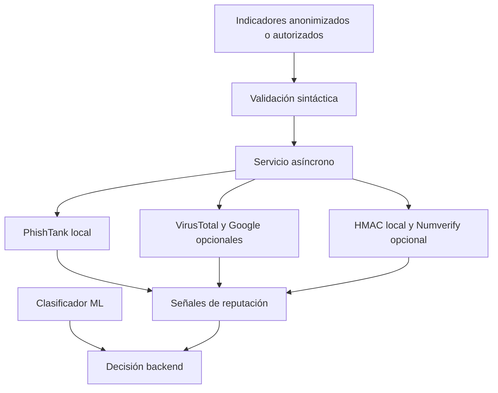

# Issue #42 — Reputation APIs

## Scope / Alcance

Componente independiente de las issues #40 y #41: consultas de URLs, dominios y teléfonos para vía rápida. El contrato fija reputación <400 ms y vía rápida total <800 ms. Esta entrega implementa los adaptadores y una interfaz de integración; no modifica el backend de Isa. La política de veredicto sigue siendo responsabilidad del backend.

## Arquitectura



El servicio devuelve `ReputationResult` con señales por proveedor, índice del indicador de entrada (sin repetir el valor), estado, motivo y puntuación opcional de política (0–100, **no probabilidad**). `actionable` solo indica presencia de una señal positiva. No hay `safe` por defecto; `no_match`, `unknown`, `unavailable` y validez telefónica no acreditan seguridad. `fast_path` devuelve clasificación y reputación sin modificar el resultado del clasificador. El backend debe decidir cómo combinar señales positivas y mantener la decisión ML si no las hay.

## Proveedores

| Proveedor | Implementación | Estado |
|---|---|---|
| VirusTotal | GET informes existentes v3, URLs y dominios | Mock probado; diagnóstico real no_match; uso no comercial por verificar |
| Google Safe Browsing | v4 Lookup, envía URL; TTL según cacheDuration | Mock probado; diagnóstico real no_match; opt-in; v5 con canonicalización y prefijos hash pendiente |
| PhishTank | Lectura local de JSON online-valid, solo verified/online=yes | Descarga y coincidencia real verificadas; actualización operativa pendiente |
| Numverify | HTTPS validación de formato/validez, no reputación | Mock probado con +34; consulta manual HTTPS de móvil español válida; pendiente repetir con el adaptador actualizado |
| Truecaller | No integrado | Acceso autorizado a API de reputación no verificado |
| Indicadores propios | Lookup en conjunto de HMAC de indicadores confirmados | Fixture probada; conectar repositorio backend pendiente |

VirusTotal y Google Safe Browsing reservan sus APIs públicas/gratuitas para uso no comercial. No se contrata ningún servicio. Los límites locales de ejemplo (VT 4/min, 500/24h; GSB 4/min, 100/24h; Numverify 1/min, 3/24h) son presupuestos conservadores por proceso, no garantías de la cuota contratada. Revisar cuotas reales antes de activar y coordinar workers y reinicios; no activar facturación u overage. No se hacen escaneos nuevos en VirusTotal. El identificador base64 de URL es reversible, no anonimización.

## Seguridad y privacidad

- Por defecto no hay consultas externas, incluso con claves configuradas. No se incluyen claves ni corpus reales.
- Solo endpoints HTTPS fijos de proveedores, sin redirecciones en consultas de reputación (la descarga explícita del feed admite un salto al CDN autorizado), sin conexión al indicador, sin resolución DNS de la URL analizada. Validación conservadora: HTTP(S), hostname público sintáctico, sin credenciales, IP literal ni puerto no estándar. No equivale a canonicalización exhaustiva ni resolución de ámbito público; pueden existir falsos negativos.
- La URL íntegra, incluido path/query, puede contener PII o secretos: **no habilitar envío real hasta que QA apruebe el flujo y se minimicen datos**. El backend debe filtrar indicadores con datos personales; no enviar mensajes de usuario completos. No confiar en base64 como anonimización. Google v4 no protege vía hashes.
- Teléfonos: formato E.164 sintáctico, no prueba de asignación. Fast path local usa función HMAC del backend sobre el número en memoria y hashes confirmados. No almacenar números en claro. Numverify solo validez, sin efecto en puntuación. No activar envío de números a terceros sin base jurídica y revisión QA.
- Instanciar un `httpx.AsyncClient` dedicado de larga vida con `follow_redirects=False`, `trust_env=False`, límites de conexiones y timeout; TLS verificado. Evitar logs HTTPX/httpcore y trazas de URLs/headers/errores sensibles. No exponer credenciales por consola, logs, telemetría ni Git.
- Cache acotada (1024) en memoria, claves HMAC efímeras. Sin cache de teléfonos, fallos, ni feed local. VT TTL 60 s de política local; Google positivos respetan duración mínima de las coincidencias, negativos no cacheados, sin caches de disco. La cache no reemplaza la retención contractual del backend.
- Presupuesto común 350 ms, máximo 10 indicadores por análisis, cancelación de tareas pendientes, sin reintentos. Proveedores deben ser cooperativos y no bloquear el event loop. El deadline no es una garantía dura si se bloquea el proceso o la cancelación tarda. Cargar feed y los hashes fuera de la vía rápida.
- Feed JSON local sin descargar dentro de petición; max 100 MB, antigüedad máxima 24 h por mtime (control operativo, no prueba de autenticidad). Obtener únicamente del sitio oficial, verificar licencia, fecha y procedencia; actualizar atómicamente, no subir ni visitar URLs de la lista. Coincidencia exacta normalizada, no reputación de todo un dominio. No se marca malicioso un dominio por una sola URL de PhishTank.

## Configuración

Variables de entorno opcionales, **no** activarlas para los tests:

- `AVIZOR_VT_KEY`
- `AVIZOR_GSB_KEY`
- `AVIZOR_NUMVERIFY_KEY`
- `AVIZOR_EXTERNAL_URLS=1` (opt-in conjunto para VT y GSB)
- `AVIZOR_EXTERNAL_PHONES=1` (opt-in Numverify)

No guardar claves en archivos versionados; verificar reglas de Git y usar secretos gestionados. El paquete no crea ni sobrescribe `.env` ni backend. `rag/requirements.txt` incluye phonenumbers para la prueba telefónica local; el backend ya usa esta biblioteca. Dependencias: Python >=3.12, httpx, pytest, pytest-cov, phonenumbers. No requiere LLM ni ChromaDB.

## Ejecución offline

Desde raíz del proyecto:

```bash
python -m pytest rag/tests/test_issue42_reputation.py -q --tb=short --cov=rag/src/reputation --cov-report=term-missing
python -m rag.src.reputation.demo
```

La demo usa `phishing.example`, un dominio reservado para ejemplos. No contacta servicios externos. La señal positiva es ficticia, el clasificador simulado.

## Integración posterior con Isa y Laura

```python
from rag.src.reputation.service import build_service, fast_path
from rag.src.reputation.providers.phishtank import PhishTank
from rag.src.reputation.phone_checker import LocalPhoneChecker

# En startup, disponer de cliente HTTPX dedicado y feed local autorizado.
# confirmed_hashes contiene SOLO indicadores confirmados, no cualquier reporte.
# backend_hmac es la función existente; no crear otra clave de HMAC persistente.
local = [PhishTank.from_file(feed_path), LocalPhoneChecker(backend_hmac, confirmed_hashes)]
service = build_service(client, local_providers=local)

# Dentro del endpoint async, classify_async() devuelve el resultado ML.
# Extraer dominios explícitamente (no se generan automáticamente).
# Cada indicador tiene forma (kind, value). No enviar texto íntegro.
classification, reputation = await fast_path(classify_async, service, indicators)
# Si no hay señales accionables, devolver clasificación sin penalización.
# Si hay señales positivas, aplicar política contractual consensuada.
```

Es un ejemplo de integración, no código ya insertado en producción. Se requiere revisar el código actual de backend para seleccionar lifespan, modelo de resultado, HMAC, umbral/política consensuados y tests de fallback real. `check_many` recibe lista/tupla de pares; limita las entradas a 10 (aplicar límites del contrato en backend). Usar `indicator_index` para correlacionar con entrada en memoria. No devolver números en claro en evidencias.

## Validación

- Tests offline con MockTransport; sin claves ni red.
- Probar respuesta maliciosa simulada, errores 404/429/5xx, redirección bloqueada, caché, cuota, validación, HMAC, fallos en paralelo y deadline.
- Confirmar latencia real con proveedor autorizado y backend integrado; medir p50/p95/p99, timeouts y fallback bajo carga. No confundir prueba sintética con phishing real confirmado.
- La URL real conocida se ha detectado sin visitarla. El fallback de extremo a extremo sigue pendiente del contrato de integración.

## Referencias oficiales

- https://docs.virustotal.com/reference/url-info
- https://docs.virustotal.com/reference/public-vs-premium-api
- https://developers.google.com/safe-browsing/v4/lookup-api
- https://developers.google.com/safe-browsing/v4/caching
- https://developers.google.com/safe-browsing/reference/Migration.From.V4
- https://developers.google.com/safe-browsing/reference/URLs.and.Hashing
- https://www.phishtank.org/developer_info.php
- https://numverify.com/documentation
- https://numverify.com/pricing
- https://docs.truecaller.com/


## Validación local — 18/11/2026 (WSL)

| Proveedor | Vía rápida | Diagnóstico | Resultado |
|---|---:|---:|---|
| PhishTank | 0,54 ms | — | malicious, score 100 |
| VirusTotal | 351,99 ms | 630,30 ms | timeout en vía rápida; no_match en diagnóstico |
| Google Safe Browsing | 351,44 ms | 456,67 ms | timeout en vía rápida; no_match en diagnóstico |
| Numverify | pendiente | pendiente | HTTP 200, valid=true, ES, mobile en consulta manual HTTPS |

Feed PhishTank: 43.538 URLs utilizables, 24.887.783 bytes. SHA256:
`2ba3dd29470d344bfe73d61c5e290fb2fb7dd91ec906d97f3eb9f24aab5fcc61`.
La consulta local excluye descarga y carga inicial. Mediciones individuales, no percentiles ni
prueba de latencia del endpoint. No_match no significa seguro. Los tiempos de timeout
son tiempos de devolución de control, no respuestas positivas de los proveedores.

### Numeración española y prueba controlada

El backend existente (`app/core/privacy.py`) ya normaliza a E.164 con región ES y
`is_possible_number`; utiliza el mismo HMAC para un número nacional o internacional.
RAG conserva su contrato de entrada E.164. No se modifica la política de hash ni de
rechazo de números del backend. El script diagnóstico aplica una comprobación más
estricta (`is_valid_number_for_region`) exclusivamente a números de prueba españoles.
Numverify admite España (+34) y solo aporta validez de numeración, no reputación.
Referencia: https://docs.apilayer.com/numverify/docs/numverify-api-v-1-0-0-2

Prueba offline (sin red, ejemplos de numeración):

```bash
python -m pytest rag/tests/test_issue42_spain.py -v -rs
```

Prueba real opcional, solo con número propio autorizado y plan HTTPS habilitado,
revisadas las condiciones del proveedor. Nunca pegar el número en argumentos ni
compartirlo en capturas. La entrada interactiva no se muestra y la salida no incluye
número ni clave. No ejecutar con números de terceros o de usuarios de Avizor.

```bash
python -c "from dotenv import load_dotenv; load_dotenv(); from rag.scripts.validate_reputation_live import main; raise SystemExit(main())" numverify --diagnostic --authorized-phone
```

Mantener `AVIZOR_EXTERNAL_PHONES=0` en operación hasta aprobación de privacidad.
El comando anterior es una prueba manual explícita, no activa el servicio en backend.
Truecaller sigue sin integrar; no se sustituye por un supuesto servicio equivalente.

### Integración pendiente

En el snapshot revisado `backend/app/services/analysis.py` llama a `decide()` de forma
síncrona; `CLASSIFIER` sigue siendo `KeywordClassifier`. La reputación actual del backend
usa recuentos locales; no llama al servicio RAG. Coordinar con Isa y Laura el punto de
integración asíncrona, la política de señales positivas, las dependencias de despliegue,
consentimiento y HMAC existente. No convertir automáticamente cualquier reporte en
indicador confirmado. La suite RAG aún no se ejecuta en CI; coordinar con QA.

### Actualización del endpoint Numverify — 18/11/2026

La consulta manual a `https://api.apilayer.net/numverify/countries` devolvió HTTP 200 y ES (+34). La consulta manual a `https://api.apilayer.net/numverify/validate` devolvió HTTP 200, `valid=true`, `country_code=ES` y `line_type=mobile`. No se registra el número ni la clave. El endpoint anterior devolvió HTTP 401. Se actualiza el adaptador a la nueva ruta HTTPS, con `country_code=ES` para números +34; para otros prefijos se conserva el formato internacional. Pendiente repetir la prueba mediante el adaptador y medir su latencia. No implica reputación de fraude ni autorización para enviar números de usuarios en producción.

Antes de este cambio: 71 tests específicos superados, cobertura de reputación 91 %, Ruff sin errores en WSL. Repetir las pruebas tras actualizar el endpoint.
