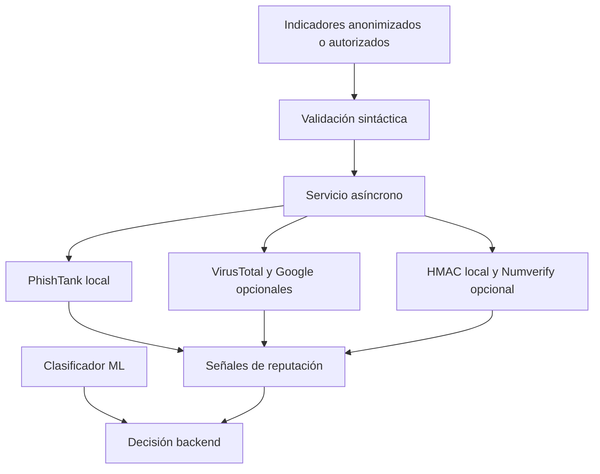

# Issue #42 — Reputation APIs

## Scope / Alcance

Componente independiente de las issues #40 y #41: consultas de URLs, dominios y teléfonos para vía rápida. El contrato fija reputación <400 ms y vía rápida total <800 ms. Esta rama incorpora los adaptadores y una propuesta de integración en la vía rápida JSON del backend. No cambia el contrato de entrada/salida. La política de veredicto y la activación de consultas externas requieren revisión de Isa y José.

## Arquitectura



El servicio devuelve `ReputationResult` con señales por proveedor, índice del indicador de entrada (sin repetir el valor), estado, motivo y puntuación opcional de política (0–100, **no probabilidad**). `actionable` solo indica presencia de una señal positiva. No hay `safe` por defecto; `no_match`, `unknown`, `unavailable` y validez telefónica no acreditan seguridad. `fast_path` devuelve clasificación y reputación sin modificar el resultado del clasificador. El backend debe decidir cómo combinar señales positivas y mantener la decisión ML si no las hay.

## Proveedores

| Proveedor | Implementación | Estado |
|---|---|---|
| VirusTotal | GET informes existentes v3, URLs y dominios | Mock probado; diagnóstico real no_match; uso no comercial por verificar |
| Google Safe Browsing | v4 Lookup, envía URL; TTL según cacheDuration | Mock probado; diagnóstico real no_match; opt-in; v5 con canonicalización y prefijos hash pendiente |
| PhishTank | Lectura local de JSON online-valid, solo verified/online=yes | Descarga y coincidencia real verificadas; actualización operativa pendiente |
| Numverify | HTTPS validación de formato/validez, no reputación | Mock probado con +34; consulta HTTPS de móvil español válida, repetida con adaptador corregido |
| Truecaller | No integrado | Acceso autorizado a API de reputación no verificado |
| Indicadores propios | Lookup en conjunto de HMAC de indicadores confirmados | Fixture probada; se conserva el contador de reportes HMAC existente del backend; no se equipara un reporte a fraude confirmado |

VirusTotal y Google Safe Browsing reservan sus APIs públicas/gratuitas para uso no comercial. No se contrata ningún servicio. Los límites locales de ejemplo (VT 4/min, 500/24h; GSB 4/min, 100/24h; Numverify 1/min, 3/24h) son presupuestos conservadores por proceso, no garantías de la cuota contratada. Revisar cuotas reales antes de activar y coordinar workers y reinicios; no activar facturación u overage. No se hacen escaneos nuevos en VirusTotal. El identificador base64 de URL es reversible, no anonimización.

## Seguridad y privacidad

- Por defecto no hay consultas externas, incluso con claves configuradas. No se incluyen claves ni corpus reales.
- Solo endpoints HTTPS fijos de proveedores, sin redirecciones en consultas de reputación (la descarga explícita del feed admite un salto al CDN autorizado), sin conexión al indicador, sin resolución DNS de la URL analizada. Validación conservadora: HTTP(S), hostname público sintáctico, sin credenciales, IP literal ni puerto no estándar. No equivale a canonicalización exhaustiva ni resolución de ámbito público; pueden existir falsos negativos.
- La URL íntegra, incluido path/query, puede contener PII o secretos: **no habilitar envío real hasta que QA apruebe el flujo y se minimicen datos**. El backend debe filtrar indicadores con datos personales; no enviar mensajes de usuario completos. No confiar en base64 como anonimización. Google v4 no protege vía hashes.
- Teléfonos: formato E.164 sintáctico, no prueba de asignación. Fast path local usa función HMAC del backend sobre el número en memoria y hashes confirmados. No almacenar números en claro. Numverify solo validez, sin efecto en puntuación. No activar envío de números a terceros sin base jurídica y revisión QA.
- Instanciar un `httpx.AsyncClient` dedicado de larga vida con `follow_redirects=False`, `trust_env=False`, límites de conexiones y timeout; TLS verificado. Evitar logs HTTPX/httpcore y trazas de URLs/headers/errores sensibles. No exponer credenciales por consola, logs, telemetría ni Git.
- Cache acotada (1024) en memoria, claves HMAC efímeras. Sin cache de teléfonos, fallos, ni feed local. VT TTL 60 s de política local; Google positivos respetan duración mínima de las coincidencias, negativos no cacheados, sin caches de disco. La cache no reemplaza la retención contractual del backend.
- Presupuesto común 350 ms, máximo 10 indicadores por análisis, cancelación de tareas pendientes, sin reintentos. Proveedores deben ser cooperativos y no bloquear el event loop. El deadline no es una garantía dura si se bloquea el proceso o la cancelación tarda. Cargar feed y los hashes fuera de la vía rápida.
- Feed JSON local sin descargar dentro de petición; max 100 MB, antigüedad máxima 24 h por mtime (control operativo, no prueba de autenticidad). Obtener únicamente del sitio oficial, verificar licencia, fecha y procedencia; actualizar atómicamente, no subir ni visitar URLs de la lista. Coincidencia exacta normalizada, no reputación de todo un dominio. No se marca malicioso un dominio por una sola URL de PhishTank.

## Configuración

Variables de entorno opcionales, **no** activarlas para los tests:

- `AVIZOR_VT_KEY`
- `AVIZOR_GSB_KEY`
- `AVIZOR_NUMVERIFY_KEY`
- `AVIZOR_EXTERNAL_URLS=1` (opt-in conjunto para VT y GSB)
- `AVIZOR_EXTERNAL_PHONES=1` (opt-in Numverify)

No guardar claves en archivos versionados; verificar reglas de Git y usar secretos gestionados. El paquete no crea ni sobrescribe `.env`; la integración modifica puntos concretos del backend y añade variables sin valores secretos a `.env.example`. `rag/requirements.txt` incluye phonenumbers para la prueba telefónica local; el backend ya usa esta biblioteca. Dependencias: Python >=3.12, httpx, pytest, pytest-cov, phonenumbers. No requiere LLM ni ChromaDB.

## Ejecución offline

Desde raíz del proyecto:

```bash
python -m pytest rag/tests/test_issue42_reputation.py -q --tb=short --cov=rag/src/reputation --cov-report=term-missing
python -m rag.src.reputation.demo
```

La demo usa `phishing.example`, un dominio reservado para ejemplos. No contacta servicios externos. La señal positiva es ficticia, el clasificador simulado.

## Integración propuesta con Isa y Laura (base `f8f6084`)

- `backend/app/services/detection/reputation.py` adapta `ReputationService` a la vía rápida JSON. El lifespan de FastAPI carga una vez el feed autorizado y crea un cliente HTTPS compartido; la caché y cuotas sobreviven entre peticiones dentro de cada proceso. Reiniciar para recargar un snapshot actualizado. Si falta, está dañado o caducado, se conserva la decisión base.
- `analyze_fast` mantiene autenticación, comprobación de dispositivo, consentimiento de monitorización, anonimización, consultas SQL, registro de actividad del dispositivo, retención, alertas y push existentes. Tras las validaciones, el backend ejecuta la evaluación base (sin acceso a la sesión SQL) y las consultas de reputación en paralelo. La sesión SQL permanece en su hilo original. La comunicación con el event loop usa `anyio.from_thread.run` desde el threadpool del endpoint.
- El clasificador sigue siendo `KeywordClassifier`, que implementa `ThreatClassifier.predict`. El modelo definitivo de Laura no figura conectado en esta versión del repositorio. No se modifica la implementación del clasificador ni se inventa un modelo. El reenvío multipart 202/agente permanece intacto; integración de ese flujo fuera de este cambio.
- PhishTank consulta URLs exactas localmente, nunca visita los sitios. VT y Google solo se habilitan con `AVIZOR_EXTERNAL_URLS=1` y `AVIZOR_REPUTATION_PUBLIC_URLS`, una lista JSON de URLs públicas previamente aprobadas por QA, sin query ni fragmento. La lista vacía impide cualquier llamada remota aunque existan claves. VT puede consultar también el hostname exacto de una URL aprobada cuando queda espacio en el límite compartido de diez indicadores. No se envían URLs arbitrarias, texto, ni teléfonos de usuarios; no se trunca un path para tratarlo como coincidencia exacta. Los fragmentos se descartan por la normalización existente. La lista de aprobación es una restricción adicional, no una base jurídica ni una garantía automática de anonimización.
- No se activa Numverify en peticiones reales: el contrato actual no proporciona consentimiento específico para comunicar teléfonos a terceros. Se mantienen `normalize_phone` ES, HMAC y reportes de Isa sin cambio. Numverify sigue disponible para pruebas expresamente autorizadas, no proporciona puntuación de fraude. Truecaller no está integrado; pendiente acordar el alcance sin acceso autorizado a una API de reputación.
- Política propuesta en `apply_url_reputation`: solo `malicious` o `suspicious` con puntuación válida; los pesos se normalizan a 0–1 y se aplican los umbrales existentes (0,4/0,7). Mantener íntegramente la decisión base cuando no hay señales positivas accionables; elevar el nivel si corresponde, nunca reducirlo. La confianza es un peso de política, no una probabilidad calibrada. Conservar plantillas de datos bancarios cuando ya corresponden. No usar validez telefónica, ausencia de coincidencias, timeout o errores para reducir el riesgo.
- Las evidencias de reputación se mantienen separadas de los hallazgos heurísticos. Se muestran motivos fijos y el dominio, no la URL completa; un positivo de una URL exacta no crea por sí solo un reporte de dominio ni de remitente. Si la decisión base ya era ámbar o roja, su política de reportes existente no se modifica.
- El backend suprime logs HTTPX/HTTPcore de sus consultas de reputación mediante filtro contextual y no registra excepciones sensibles. Revisar además instrumentación y proxies antes de habilitar tráfico externo. No se activa facturación. Mantener la revisión de derechos de uso de proveedores.
- El presupuesto de reputación sigue siendo 350 ms compartidos; no se promete un SLA duro frente a saturación, bloqueo del event loop o cancelación no cooperativa. Medir extremo a extremo en WSL con PostgreSQL y después con el modelo definitivo y carga representativa.

### Configuración segura del backend

```dotenv
AVIZOR_PHISHTANK_LOCAL=1
AVIZOR_EXTERNAL_URLS=0
AVIZOR_REPUTATION_PUBLIC_URLS=[]
AVIZOR_EXTERNAL_PHONES=0
```

Estas variables son los valores seguros de ejemplo. `AVIZOR_EXTERNAL_PHONES` se conserva para el componente independiente, pero no habilita envíos telefónicos desde el endpoint. Las claves permanecen en `.env` ignorado; no se reproducen aquí. El backend resuelve el módulo `rag` desde la raíz de este monorepo para permitir el arranque habitual desde `backend/`. No requiere instalar ChromaDB ni sentence-transformers para esta integración.

### Prueba real concurrente controlada

```bash
python -m rag.scripts.validate_reputation_parallel
# Opcional, solo con un número propio y autorización expresa:
python -m rag.scripts.validate_reputation_parallel --authorized-phone
```

Utiliza el feed local ya descargado y los indicadores públicos de las pruebas anteriores para VT y Google; jamás comparte el indicador del feed con un proveedor remoto. Solo con el parámetro explícito solicita un teléfono español autorizado mediante entrada oculta. Carga `.env` desde la raíz del repositorio. Una ejecución consume consultas de los proveedores habilitados, no se repite automáticamente. La salida incluye solo estado, puntuación, motivo y tiempo conjunto; código cero significa coincidencia local positiva y presupuesto inferior a 400 ms, no disponibilidad de todas las APIs. Si el feed caducó, obtener un snapshot nuevo de la fuente oficial de forma explícita tras revisar cuota y permisos. Esta prueba mide el servicio, no la latencia HTTP de Avizor.

### Tests de integración offline

```bash
python -m pytest backend/tests/test_reputation_bridge.py backend/tests/test_reputation_endpoint.py -q --tb=short -rs
python -m pytest rag/tests/test_issue42*.py -q -rs --cov=rag/src/reputation --cov-report=term-missing
```

Los tests de puente prueban coincidencia positiva, no degradación, ausencia de coincidencias, caída, timeout, concurrencia efectiva, egress limitado, arranque con feed local y ejecución desde el worker AnyIO. Los tests de endpoint requieren PostgreSQL migrado y comprueban alerta, ausencia de reportes nuevos por una señal externa aislada, fallback y tiempo local inferior a 800 ms, autorización previa y ciclo de vida real de la API. Todos los proveedores de tests están simulados o usan snapshots sintéticos; no se consumen cuotas. No habilitar envíos reales para CI.

## Validación

- Tests offline con MockTransport; sin claves ni red.
- Probar respuesta maliciosa simulada, errores 404/429/5xx, redirección bloqueada, caché, cuota, validación, HMAC, fallos en paralelo y deadline.
- Confirmar latencia real con proveedor autorizado y backend integrado; medir p50/p95/p99, timeouts y fallback bajo carga. No confundir prueba sintética con phishing real confirmado.
- La URL real conocida se ha detectado sin visitarla. El fallback de extremo a extremo se ha probado en PostgreSQL local (véanse evidencias posteriores); queda revisar la política de integración con el equipo.

## Referencias oficiales

- https://docs.virustotal.com/reference/url-info
- https://docs.virustotal.com/reference/public-vs-premium-api
- https://developers.google.com/safe-browsing/v4/lookup-api
- https://developers.google.com/safe-browsing/v4/caching
- https://developers.google.com/safe-browsing/reference/Migration.From.V4
- https://developers.google.com/safe-browsing/reference/URLs.and.Hashing
- https://www.phishtank.org/developer_info.php
- https://numverify.com/documentation
- https://numverify.com/pricing
- https://docs.truecaller.com/


## Validación local — 18/11/2026 (WSL)

| Proveedor | Vía rápida | Diagnóstico | Resultado |
|---|---:|---:|---|
| PhishTank | 0,54 ms | — | malicious, score 100 |
| VirusTotal | 351,99 ms | 630,30 ms | timeout en vía rápida; no_match en diagnóstico |
| Google Safe Browsing | 351,44 ms | 456,67 ms | timeout en vía rápida; no_match en diagnóstico |
| Numverify | 352,65 ms | 628,47 ms | timeout en vía rápida; valid en diagnóstico con adaptador propio, móvil español |

Feed PhishTank: 43.538 URLs utilizables, 24.887.783 bytes. SHA256:
`2ba3dd29470d344bfe73d61c5e290fb2fb7dd91ec906d97f3eb9f24aab5fcc61`.
La consulta local excluye descarga y carga inicial. Mediciones individuales, no percentiles ni
prueba de latencia del endpoint. No_match no significa seguro. Los tiempos de timeout
son tiempos de devolución de control, no respuestas positivas de los proveedores.

### Numeración española y prueba controlada

El backend existente (`app/core/privacy.py`) ya normaliza a E.164 con región ES y
`is_possible_number`; utiliza el mismo HMAC para un número nacional o internacional.
RAG conserva su contrato de entrada E.164. No se modifica la política de hash ni de
rechazo de números del backend. El script diagnóstico aplica una comprobación más
estricta (`is_valid_number_for_region`) exclusivamente a números de prueba españoles.
Numverify admite España (+34) y solo aporta validez de numeración, no reputación.
Referencia: https://docs.apilayer.com/numverify/docs/numverify-api-v-1-0-0-2

Prueba offline (sin red, ejemplos de numeración):

```bash
python -m pytest rag/tests/test_issue42_spain.py -v -rs
```

Prueba real opcional, solo con número propio autorizado y plan HTTPS habilitado,
revisadas las condiciones del proveedor. Nunca pegar el número en argumentos ni
compartirlo en capturas. La entrada interactiva no se muestra y la salida no incluye
número ni clave. No ejecutar con números de terceros o de usuarios de Avizor.

```bash
python -c "from dotenv import load_dotenv; load_dotenv(); from rag.scripts.validate_reputation_live import main; raise SystemExit(main())" numverify --diagnostic --authorized-phone
```

Mantener `AVIZOR_EXTERNAL_PHONES=0` en operación hasta aprobación de privacidad.
El comando anterior es una prueba manual explícita, no activa el servicio en backend.
Truecaller sigue sin integrar; no se sustituye por un supuesto servicio equivalente.

### Situación anterior al puente (referencia histórica)

En el snapshot revisado antes de incorporar el puente `backend/app/services/analysis.py` llama a `decide()` de forma
síncrona; `CLASSIFIER` sigue siendo `KeywordClassifier`. La reputación actual del backend
usa recuentos locales; no llama al servicio RAG. Coordinar con Isa y Laura el punto de
integración asíncrona, la política de señales positivas, las dependencias de despliegue,
consentimiento y HMAC existente. No convertir automáticamente cualquier reporte en
indicador confirmado. La suite RAG aún no se ejecuta en CI; coordinar con QA.

### Actualización del endpoint Numverify — 18/11/2026

La consulta manual a `https://api.apilayer.net/numverify/countries` devolvió HTTP 200 y ES (+34). La consulta manual a `https://api.apilayer.net/numverify/validate` devolvió HTTP 200, `valid=true`, `country_code=ES` y `line_type=mobile`. No se registra el número ni la clave. El endpoint anterior devolvió HTTP 401. Se actualiza el adaptador a la nueva ruta HTTPS, con `country_code=ES` para números +34; para otros prefijos se conserva el formato internacional. La prueba posterior mediante el adaptador devolvió `valid` en diagnóstico (628,47 ms) y `deadline_exceeded` en vía rápida (352,65 ms). No implica reputación de fraude ni autorización para enviar números de usuarios en producción.

Tras actualizar el endpoint: 71 tests específicos superados, cobertura de reputación 91 %, Ruff sin errores en WSL. Repetir las pruebas tras incorporar el puente.

## Evidencias antes de conectar el backend — WSL

- Commit de proveedores `1871f8f`, merge local `f8f6084` con `origin/dev` `a751cb1`, esquema PostgreSQL `0005 (head)`.
- 335 tests backend y 230 RAG superados: 565 en total antes de esta integración; 71 específicos de reputación y cobertura previa del 91 %.
- Numverify corregido: diagnóstico `valid` a 628,47 ms, vía rápida `deadline_exceeded` a 352,65 ms. `.env` y feed comprobados como ignorados y no seguidos por Git.
- La línea base se conserva como referencia histórica; los resultados posteriores se recogen a continuación.

## Evidencias posteriores al puente — 18/11/2026 (WSL)

- Regresión: 350 tests backend y 231 RAG, 581 en total, sin fallos. Incluye 15 tests de integración backend y 72 específicos RAG; cobertura del módulo `rag/src/reputation`: 91 %, no del backend completo.
- Tras corregir Ruff: 152 archivos correctamente formateados, sin incidencias de lint; los 15 tests específicos backend se repitieron satisfactoriamente (6,39 s). La regresión completa anterior no se presenta como una nueva ejecución posterior a Ruff.
- Prueba real paralela: 351,23 ms en conjunto, por debajo de 400 ms. PhishTank devolvió `malicious`, 100/100; VirusTotal, Google y Numverify devolvieron `deadline_exceeded`, sin puntuación. No se consultó la URL del feed en proveedores remotos.
- El test del endpoint con timeout y PostgreSQL verificó respuesta inferior a 800 ms y conservación del veredicto base. No es una garantía de latencia bajo carga ni con el modelo definitivo de ML.
- `.env` y el feed se comprobaron ignorados y no seguidos por Git. `git diff --check` no mostró incidencias en archivos seguidos antes de la auditoría.

## Revisión de seguridad y operación

- Rechazar también snapshots vacíos o sin entradas utilizables al cargar desde disco; un feed inválido no debe aparentar ausencia de coincidencias. El backend conserva la clasificación base si no puede cargar el feed.
- El snapshot se carga una vez por proceso en el lifespan. Caduca a las 24 horas según mtime. Tras una renovación autorizada y atómica, reiniciar el backend para cargar el nuevo archivo. Si falta o caduca, continuar con la clasificación base. No hay actualización automática ni indicador de salud específico todavía; acordar operación y procedencia/licencia con QA.
- La lista de URLs públicas exactas limita el envío externo, pero no sustituye revisión humana del path, base jurídica y telemetría. Mantener `AVIZOR_EXTERNAL_URLS=0` y `AVIZOR_EXTERNAL_PHONES=0` por defecto. Numverify queda disponible para pruebas autorizadas, no en tráfico de usuarios. Truecaller no implementado; acordar esta limitación expresamente.
- El filtro contextual reduce exposición en logs HTTPX/HTTPcore conocidos; no garantiza ausencia de datos en toda la instrumentación del despliegue. Revisar APM, proxies y registros antes de habilitar tráfico real.
- CI actual ejecuta backend, mobile y ML, no la suite RAG. Proponer a José un job offline para `rag/tests/test_issue42*.py` con dependencias mínimas y lint RAG. No incluir claves ni descargar feeds en CI. El backend necesita el paquete `rag/src/reputation` presente en el despliegue del monorepo y `httpx` (ya declarado en requisitos backend del snapshot base).
- Pendientes de aprobación: Isa (política de decisión e integración), Laura (modelo final y medición), José (privacidad, licencias, CI y operación). Cuotas por proceso no equivalen a un límite global; no habilitar uso comercial o facturación sin revisar condiciones.
- Tras los cambios de auditoría (rechazo de feed vacío y test de filtrado de logs), repetir lint y regresión completa en WSL antes del commit final; no se contabilizan como superados hasta su ejecución.
